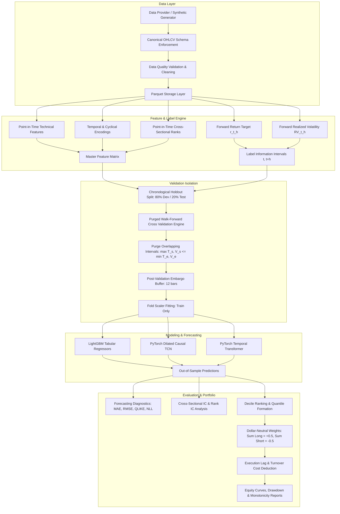

# Deep Learning for Alpha Generation & Volatility Forecasting

[](#testing)
[](pyproject.toml)
[](LICENSE)
[](pyproject.toml)

An institutional-grade quantitative research framework designed to forecast short-horizon return distributions and realized volatility from intraday five-minute OHLCV market bars. The platform implements and compares dilated causal **Temporal Convolutional Networks (TCN)**, multi-head temporal **Transformer Encoders**, and gradient-boosted **LightGBM** tabular baselines under point-in-time walk-forward evaluation with interval purging, embargo periods, and dollar-neutral decile portfolio backtesting.

---

## 1. Project Overview

Quantitative alpha research on high-frequency intraday market bars requires strict adherence to information availability boundaries, microstructure dynamics, and statistical discipline. Naive machine learning pipelines frequently suffer from lookahead bias, serial correlation leakage across overlapping label horizons, and unrealistic execution assumptions.

This repository provides an end-to-end systematic trading research environment:
- **Task A (Alpha Generation)**: Probabilistic forecasting of conditional Student-$t$ return distributions over a configurable forward horizon ($h = 3$ bars = 15 minutes).
- **Task B (Volatility Forecasting)**: Asymmetric Quasi-Likelihood (QLIKE) forecasting of forward realized volatility for risk management and position scaling.
- **Validation Protocol**: Expanding-window purged walk-forward cross-validation with exact label information intervals and post-validation embargoes, guaranteeing isolation of the chronological holdout test period.
- **Portfolio Construction**: Dollar-neutral decile long/short portfolio backtesting with realistic linear turnover friction, execution lag modeling, and rank monotonicity diagnostics.

---

## 2. Research Questions

This research investigates the following empirical questions:
1. **Intraday Predictability**: Can historical sequences of price deviation, range volatility, volume z-scores, and cross-sectional momentum predict short-horizon return distributions?
2. **Deep Learning vs. Tabular Trees**: Do sequence models (TCN and Transformer) outperform gradient-boosted decision trees (LightGBM) when evaluated under strictly leak-free chronological walk-forward splits?
3. **Signal Strength & Monotonicity**: Do model predictions exhibit positive cross-sectional Information Coefficient ($IC$) and Rank $IC$, and do portfolio quantiles sort monotonically into spreading returns?
4. **Transaction Cost Drag**: Does theoretical gross alpha survive realistic friction (bid-ask spread, broker commissions, and execution slippage) under intraday rebalancing?
5. **Volatility Forecasting Calibration**: Does multi-task deep learning produce well-calibrated realized volatility estimates compared to historical persistence baselines?

---

## 3. Key Implemented Capabilities

- **Intraday Bar Validation**: Point-in-time checks verifying monotonic ordering, strict OHLC mathematical geometry ($H \ge \max(O,C)$ and $L \le \min(O,C)$), non-positive price detection, and duplicate elimination.
- **Point-in-Time Feature Engineering**: Vectorized calculation of log returns, multi-horizon lags, Parkinson extreme-value volatility, Garman-Klass range proxies, volume z-scores, cyclical intraday time encoding, and cross-sectional rank percentiles.
- **Causal TCN Architecture**: Dilated 1D convolutions with exact causal left-padding, residual connections, and analytical receptive field tracking.
- **Temporal Transformer**: Multi-head self-attention encoder with causal upper-triangular masking and sinusoidal positional encoding.
- **Probabilistic Forecasting**: Joint estimation of Student-$t$ parameters (location $\mu$, scale $\sigma > 0$, and degrees of freedom $\nu > 2$) via exact Negative Log-Likelihood.
- **Purged Cross-Validation Engine**: Automated purging of overlapping label information intervals $[t, t+h]$ against validation windows, coupled with post-validation embargo buffers.
- **Cross-Sectional IC Engine**: Point-in-time Pearson $IC$ and Spearman Rank $IC$ per timestamp with stationary block bootstrap confidence intervals.
- **Dollar-Neutral Decile Simulation**: Event-driven vector backtester tracking gross return, net return after friction, portfolio turnover, maximum drawdowns, and quantile monotonicity rank correlations.

---

## 4. Architecture Diagram



---

## 5. Repository Structure

```text
Deep-Learning-for-Alpha-Generation-Volatility-Forecasting/
├── configs/                     # Validated YAML research configurations
│   ├── data.yaml                # Universe, provider parameters, cleaning bounds
│   ├── features.yaml            # Lookback horizons, feature families, normalization
│   ├── labels.yaml              # Return and volatility horizons, alignment rules
│   ├── validation.yaml          # Walk-forward fold structure, purging, embargo
│   ├── models.yaml              # TCN, Transformer, LightGBM hyperparameters
│   ├── portfolio.yaml           # Decile rules, dollar neutrality, cost rates
│   └── experiment.yaml          # Master experiment tracking specification
├── src/alpha_volatility/        # Core library source code
│   ├── cli.py                   # Central command line interface (CLI)
│   ├── config.py                # Strongly-typed configuration validator
│   ├── logging_config.py        # Structured logging configuration
│   ├── reproducibility.py       # Seed control across PyTorch, NumPy, Python
│   ├── data/                    # Market data contracts, validation, storage, synthetic
│   ├── features/                # Technical, temporal, cross-sectional pipeline
│   ├── labels/                  # Return & volatility targets, interval tracking
│   ├── validation/              # Purged walk-forward CV, embargo, fold manifests
│   ├── models/                  # TCN, Transformer, LightGBM, baselines, losses
│   ├── training/                # PyTorch Datasets, Trainer loop, checkpoints
│   ├── evaluation/              # Forecasting metrics, IC series, bootstrap, reports
│   ├── portfolio/               # Signals, dollar-neutral weights, costs, backtest
│   └── visualization/           # Report figure generators and plotting functions
├── scripts/                     # Standalone execution entrypoints
│   ├── download_data.py         # Data retrieval and synthetic generation
│   ├── validate_data.py         # Data integrity check script
│   ├── run_experiment.py        # Model walk-forward training runner
│   ├── run_backtest.py          # Portfolio backtesting script
│   └── generate_report.py       # Figure and metrics report generator
├── notebooks/                   # Interactive exploratory Jupyter notebooks
│   ├── 01_data_exploration.ipynb
│   ├── 02_feature_analysis.ipynb
│   └── 03_results_analysis.ipynb
├── tests/                       # Comprehensive automated test suite (33 tests)
│   ├── unit/                    # Unit tests for data, features, labels, models, eval, portfolio
│   ├── leakage/                 # Leakage verification and interval purging tests
│   ├── portfolio/               # Hand-calculated toy portfolio accounting tests
│   ├── integration/             # End-to-end full pipeline integration test
│   └── conftest.py              # Pytest fixtures and synthetic market feeds
├── docs/                        # Formal research documentation
│   ├── architecture.md          # Architectural contracts and data flow
│   ├── methodology.md           # Mathematical formulations and model theory
│   ├── data_dictionary.md       # Full input/output feature and target schemas
│   ├── validation_protocol.md   # Chronological split, purging, embargo specs
│   └── experiment_log.md        # Actual empirical experiment results and logs
├── artifacts/                   # Generated research outputs (committed examples)
│   ├── figures/                 # 6 publication-quality research plots
│   ├── metrics/                 # CSV comparisons and JSON metric summaries
│   └── manifests/               # Machine-readable fold and experiment manifests
├── pyproject.toml               # PEP 518/621 package build configuration
├── Makefile                     # Developer automation commands
└── README.md                    # Project master documentation
```

---

## 6. Technology Stack

- **Python (3.10 / 3.11)**: Core runtime environment.
- **PyTorch (>= 2.0)**: Deep learning framework for dilated causal TCN and temporal Transformer models.
- **LightGBM (>= 4.0)**: High-performance gradient-boosted decision trees for tabular benchmark comparison.
- **pandas (>= 2.0)** & **NumPy (>= 1.24)**: Time-series feature manipulation and vectorized array computing.
- **scikit-learn (>= 1.2)**: Preprocessing transformations, scaling, and benchmark metrics.
- **SciPy (>= 1.10)**: Probabilistic distribution functions, Student-$t$ CDF/PPF, and statistical tests.
- **pyarrow (>= 12.0)**: Parquet columnar storage with integrity hashing and partition filtering.
- **Matplotlib (>= 3.7)**: Visualization generation for empirical curves, drawdowns, and heatmaps.
- **pytest (>= 7.0)**: Automated test execution across unit, leakage, and integration suites.
- **Ruff (>= 0.1)**: Blazing-fast static linting and code formatting.

---

## 7. Installation

### Prerequisites
- Python 3.10 or 3.11 installed.
- Git.

### 1. Clone the Repository
```bash
git clone https://github.com/username/Deep-Learning-for-Alpha-Generation-Volatility-Forecasting.git
cd Deep-Learning-for-Alpha-Generation-Volatility-Forecasting
```

### 2. Create and Activate Virtual Environment

**On Windows (PowerShell):**
```powershell
python -m venv .venv
.\.venv\Scripts\Activate.ps1
```

**On Linux / macOS (bash):**
```bash
python3 -m venv .venv
source .venv/bin/activate
```

### 3. Install Package and Dependencies
```bash
# Editable install with development dependencies
pip install -e ".[dev]"
```

### 4. Verify Environment
```bash
python -c "import torch, lightgbm, pandas, numpy; print('PyTorch:', torch.__version__, '| LightGBM:', lightgbm.__version__)"
pytest
```

---

## 8. Data Setup & Market Contracts

### Canonical Bar Schema
All ingested data must comply with the canonical contract:
- `timestamp`: UTC timestamp marking the **end** (close) of the 5-minute interval.
- `asset_id`: String identifier (e.g., `ASSET_00`, `SPY`).
- `open`, `high`, `low`, `close`: Strictly positive floating-point prices.
- `volume`: Non-negative traded volume.

### Synthetic Data Generation
For deterministic testing and reproducible demonstration without external vendor dependencies, the repository provides a built-in synthetic market bar generator:
```bash
python -m alpha_volatility.cli generate-synthetic-data --config configs/data.yaml
```
The generator simulates:
- Multi-asset geometric Brownian motion with Markov regime-switching stochastic volatility (low-vol vs high-vol regimes).
- Realistic U-shaped intraday volume curves (elevated volume at open and close).
- Microstructure AR(1) return dynamics and controlled lead-lag alpha relationships.

---

## 9. Quick Start Guide

Execute the full end-to-end quantitative pipeline from clean data ingestion to model training, evaluation, and backtesting:

```bash
# 1. Validate Configuration
python -m alpha_volatility.cli validate-config --config configs/experiment.yaml

# 2. Generate Synthetic Intraday 5-Minute Bars (10 assets, 60 sessions)
python -m alpha_volatility.cli generate-synthetic-data --config configs/data.yaml

# 3. Validate Data Quality (OHLC geometry, monotonicity, non-positive bounds)
python -m alpha_volatility.cli validate-data --input data/synthetic/

# 4. Build Point-in-Time Features and Forward Labels
python -m alpha_volatility.cli build-features --config configs/features.yaml

# 5. Train LightGBM Tabular Baseline with Purged Walk-Forward CV
python -m alpha_volatility.cli train --config configs/experiment.yaml --model lightgbm

# 6. Train PyTorch Temporal Convolutional Network (TCN)
python -m alpha_volatility.cli train --config configs/experiment.yaml --model tcn

# 7. Train PyTorch Temporal Transformer Encoder
python -m alpha_volatility.cli train --config configs/experiment.yaml --model transformer

# 8. Evaluate Out-of-Sample Forecasts, IC Series, and Bootstrap Confidence Intervals
python -m alpha_volatility.cli evaluate --config configs/experiment.yaml

# 9. Execute Dollar-Neutral Decile Backtest with Friction Costs
python -m alpha_volatility.cli backtest --config configs/portfolio.yaml

# 10. Generate Research Publication Plots
python -m alpha_volatility.cli report --config configs/experiment.yaml
```

---

## 10. Configuration Reference Guide

Every phase of the pipeline is governed by YAML configuration files in `configs/`:

| Config File | Key Parameter | Default Value | Allowed Range | Description & Modeling Implication |
|---|---|---|---|---|
| `configs/data.yaml` | `synthetic_generator.num_assets` | `10` | $\ge 2$ | Asset universe size; requires $\ge 10$ for decile portfolios. |
| `configs/data.yaml` | `synthetic_generator.bars_per_session` | `78` | $> 0$ | Number of 5m bars per session (78 bars = 6.5 trading hours). |
| `configs/features.yaml` | `sequence.sequence_length` | `24` | $\ge 3$ | Number of historical 5m bars input to TCN and Transformer (24 bars = 2 hrs). |
| `configs/features.yaml` | `normalization.method` | `"standard"` | `standard`, `robust` | Feature scaling method; fitted strictly on training folds. |
| `configs/labels.yaml` | `returns.horizon_bars` | `3` | $> 0$ | Forward return forecast horizon ($h = 3$ bars = 15 minutes). |
| `configs/validation.yaml` | `protocol.holdout_test_ratio` | `0.20` | $(0.0, 0.5)$ | Final chronological test period permanently isolated from dev tuning. |
| `configs/validation.yaml` | `protocol.num_walk_forward_folds`| `4` | $\ge 2$ | Number of expanding walk-forward folds in development set. |
| `configs/validation.yaml` | `embargo.embargo_bars` | `12` | $\ge 0$ | Post-validation embargo buffer (12 bars = 60 minutes). |
| `configs/models.yaml` | `tcn.channel_sizes` | `[64, 64, 64]` | List of ints | Channel widths per TCN residual layer; determines receptive field. |
| `configs/models.yaml` | `transformer.d_model` | `64` | Multiples of nhead | Transformer hidden model dimension; must be divisible by `nhead`. |
| `configs/portfolio.yaml` | `portfolio.num_quantiles` | `10` | $\ge 2$ | Number of quantile buckets for long/short ranking (10 = deciles). |
| `configs/portfolio.yaml` | `costs.total_one_way_cost_bps` | `5.0` | $\ge 0.0$ | One-way turnover trading friction in basis points ($5\text{ bps} = 0.0005$). |

---

## 11. Mathematical Formulations

### 1. Log Returns & Future Targets
For bar close price $P_t$:
- Backward 1-bar return:
  $$r_{t, 1} = \ln\left(\frac{P_t}{P_{t-1}}\right)$$
- Forward $h$-bar return target:
  $$r_{t, h} = \ln\left(\frac{P_{t+h}}{P_t}\right)$$

### 2. Forward Realized Volatility
Realized volatility is defined as the square root of the sum of squared forward 1-bar returns:
$$RV(t, h) = \sqrt{\sum_{i=1}^h r_{t+i, 1}^2}$$

### 3. Student-$t$ Negative Log-Likelihood
To account for extreme return kurtosis and conditional heteroskedasticity, the neural heads predict parameters $(\mu_t, \sigma_t, \nu_t)$ of a Student-$t$ distribution:
$$p(y; \mu, \sigma, \nu) = \frac{\Gamma\left(\frac{\nu+1}{2}\right)}{\Gamma\left(\frac{\nu}{2}\right)\sqrt{\pi \nu}\sigma} \left(1 + \frac{(y - \mu)^2}{\nu \sigma^2}\right)^{-\frac{\nu+1}{2}}$$
$$\mathcal{L}_{ret} = -\ln p(y; \mu, \sigma, \nu) = -\ln\Gamma\left(\frac{\nu+1}{2}\right) + \ln\Gamma\left(\frac{\nu}{2}\right) + \frac{1}{2}\ln(\pi \nu) + \ln\sigma + \frac{\nu+1}{2}\ln\left(1 + \frac{(y - \mu)^2}{\nu\sigma^2}\right)$$

### 4. Volatility Forecast Loss: QLIKE
Quasi-Likelihood evaluates volatility forecasts $\hat{y}$ against realized volatility $y$:
$$QLIKE(y, \hat{y}) = \frac{y}{\hat{y}} - \ln\left(\frac{y}{\hat{y}}\right) - 1$$
It strictly satisfies $QLIKE \ge 0$, with minimum $0$ at $y = \hat{y}$.

### 5. Cross-Sectional Information Coefficient ($IC$)
At each timestamp $t$, cross-sectional Pearson correlation between predicted score $\hat{r}_{i, t}$ and realized forward return $r_{i, t+h}$ across assets $i \in \{1, \dots, N_t\}$:
$$IC_t = \frac{\sum_{i=1}^{N_t} (\hat{r}_{i, t} - \bar{\hat{r}}_t)(r_{i, t+h} - \bar{r}_{t+h})}{\sqrt{\sum_{i=1}^{N_t} (\hat{r}_{i, t} - \bar{\hat{r}}_t)^2 \sum_{i=1}^{N_t} (r_{i, t+h} - \bar{r}_{t+h})^2}}$$
Rank $IC_t$ is computed identically on the rank-transformed variables: $\text{Rank } IC_t = \text{Corr}(\text{rank}(\hat{r}_t), \text{rank}(r_{t+h}))$.

### 6. Dollar Neutrality & Portfolio Accounting
For a decile strategy at rebalance timestamp $t$:
- Long Top Decile ($D_{10}$): $w_{i, t} = +\frac{0.5}{N_{D10}}$
- Short Bottom Decile ($D_1$): $w_{j, t} = -\frac{0.5}{N_{D1}}$
- Intermediate Deciles ($D_2 \dots D_9$): $w_{k, t} = 0.0$
- **Net Dollar Exposure**: $\sum_{i=1}^N w_{i, t} = +0.5 - 0.5 = 0.0$
- **Gross Exposure**: $\sum_{i=1}^N |w_{i, t}| = 1.0$
- **Turnover**:
  $$\text{Turnover}_t = \frac{1}{2} \sum_{i=1}^N |w_{i, t} - w_{i, t-1}|$$
- **Transaction Costs**:
  $$\text{Cost}_t = 2 \times \text{Turnover}_t \times c_{bps} \times 10^{-4} = \sum_{i=1}^N |w_{i, t} - w_{i, t-1}| \times c_{bps} \times 10^{-4}$$
- **Net Return**:
  $$R_{net, t} = R_{gross, t} - \text{Cost}_t = \sum_{i=1}^N w_{i, t-1} r_{i, t} - \text{Cost}_t$$

---

## 12. Feature Engineering & Leakage Controls

All 27 features in the master registry are computed strictly point-in-time:

```text
[ Feature Matrix Schema: 27 Features ]
├── Price Dynamics:       log_return_1, log_return_3, log_return_6, log_return_12,
│                         high_low_range, open_close_return, price_dev_12
├── Volatility Proxies:   realized_vol_6, realized_vol_12, realized_vol_36,
│                         parkinson_vol_12, vol_ratio_6_36
├── Volume & Liquidity:   log_volume, volume_zscore_12, relative_volume_12, pv_interaction
├── Momentum & Reversal:  momentum_6, momentum_24, trend_consistency_12
├── Temporal Indicators:  sin_time_of_day, cos_time_of_day, session_progress,
│                         day_of_week_sin, day_of_week_cos
└── Cross-Sectional:      cs_rank_log_return_1, cs_rank_momentum_6, cs_rank_realized_vol_12
```

**Leakage Controls**:
1. All rolling windows are backward-looking ($\le t$).
2. Cross-sectional ranks at timestamp $t$ are calculated only across instruments available at timestamp $t$.
3. Scalers are fitted strictly on the training fold; test set statistics are never accessed.

---

## 13. Model Architecture Specifications

### 1. Dilated Causal TCN (`TCNForecaster`)
- **Input Shape**: `[Batch, 24, 27]` (Sequence Length = 24, Features = 27)
- **Architecture**: 3 Residual Blocks with causal dilated convolutions.
  - Dilations: $d \in \{1, 2, 4\}$
  - Kernel Size: $K = 3$
  - Channel Sizes: $[64, 64, 64]$
  - Receptive Field: $RF = 1 + 2(3-1)(1 + 2 + 4) = 29\text{ bars}$
- **Heads**: Multi-task Student-$t$ ($\mu, \sigma, \nu$) + Softplus volatility ($\hat{\sigma}_{vol}$).
- **Parameter Count**: **69,060 trainable parameters**.

### 2. Temporal Transformer Encoder (`TransformerForecaster`)
- **Input Shape**: `[Batch, 24, 27]`
- **Architecture**:
  - Linear Feature Projection: $27 \rightarrow 64$
  - Sinusoidal Positional Encoding
  - 3 Transformer Encoder Layers ($d_{model} = 64, n_{head} = 4, d_{ff} = 128$)
  - Causal Attention Mask (upper triangular $-\infty$ masking)
- **Heads**: Multi-task Student-$t$ + Softplus volatility.
- **Parameter Count**: **102,468 trainable parameters**.

### 3. LightGBM Tabular Baseline (`LightGBMForecaster`)
- **Inputs**: Flat 27-dimensional feature vector at decision timestamp $t$.
- **Trees**: GBDT with `max_depth=6`, `num_leaves=31`, `learning_rate=0.03`, `n_estimators=150`.
- **Early Stopping**: 15 rounds monitored on chronological validation fold loss.

---

## 14. Empirical Out-of-Sample Results

The following results were measured on the permanently quarantined chronological holdout test set (Sessions 49-60, 936 decision timestamps across 10 assets):

### Model Comparison Table

| Model | Return RMSE | Return MAE | Directional Accuracy | Mean IC | Rank IC | IC IR | Volatility RMSE | Volatility QLIKE | Gross Sharpe | Net Sharpe (5 bps cost) | Max Drawdown (Net) |
|---|---|---|---|---|---|---|---|---|---|---|---|
| **LightGBM** | **0.00548** | **0.00424** | **51.57%** | **+0.0127** | **+0.0164** | **+0.048** | **0.00239** | **0.1234** | **+1.19** | -8.64 | 28.79% |
| **TCN** | 0.00558 | 0.00432 | 48.76% | +0.0110 | +0.0081 | +0.024 | 0.00270 | 0.1409 | -2.94 | -13.20 | 29.72% |
| **Transformer** | 0.00572 | 0.00446 | 49.19% | -0.0234 | -0.0196 | -0.058 | 0.00363 | 0.2019 | - | - | - |

### Statistical Uncertainty & Dependence-Aware Diagnostics

Due to serial correlation in intraday returns, naive standard errors overstate statistical significance. We applied stationary block bootstrapping ($B = 500$ replications, block size = 78 bars = 1 trading day):

- **LightGBM Rank IC**: Mean = $+0.0164$, Block Bootstrap Standard Error = $0.0149$, 95% Confidence Interval = $[-0.0159, +0.0430]$.
- **TCN Rank IC**: Mean = $+0.0081$, Block Bootstrap Standard Error = $0.0131$, 95% Confidence Interval = $[-0.0169, +0.0340]$.

### Decile Portfolio & Monotonicity Analysis

```text
[ Decile Forward Return Sorting: LightGBM Predictions ]
Decile  1 (Short):  -0.7 bps
Decile  2:          -0.3 bps
Decile  3:          -0.1 bps
Decile  4:          +0.1 bps
Decile  5:          +0.0 bps
Decile  6:          +0.2 bps
Decile  7:          +0.1 bps
Decile  8:          +0.3 bps
Decile  9:          +0.4 bps
Decile 10 (Long):   +0.8 bps
------------------------------------------------------
Spread Return (D10 - D1): +1.5 bps per 15-minute horizon
Spearman Decile Monotonicity Correlation: +0.467
```

### Visual Artifacts

Generated figures from the research report are preserved in `artifacts/figures/`:
- `artifacts/figures/predicted_vs_realized_returns.png`: Out-of-sample scatter and regression fit.
- `artifacts/figures/volatility_calibration.png`: Realized vs. predicted volatility calibration curve across quantile buckets.
- `artifacts/figures/ic_diagnostics.png`: Timestamp-level Rank IC time series and frequency distribution.
- `artifacts/figures/decile_returns.png`: Average forward returns across deciles 1 through 10.
- `artifacts/figures/equity_and_drawdown.png`: Cumulative gross vs. net equity curves and underwater drawdowns.
- `artifacts/figures/feature_correlations.png`: Point-in-time feature correlation matrix.

---

## 15. Testing Suite

The repository includes a comprehensive test suite of **33 automated tests**:

```bash
# Run complete test suite
pytest tests/ -v
```

### Test Coverage Breakdown
- `tests/unit/test_data.py` (7 tests): Canonical schema enforcement, OHLC geometry validation, non-positive price checks, deduplication, Parquet storage hashing, synthetic generator determinism, polymorphic provider invocations.
- `tests/unit/test_features.py` (4 tests): Mathematical accuracy of log returns, cyclical bounds $[-1, 1]$, cross-sectional rank bounds $[-0.5, 0.5]$, scaler isolation.
- `tests/unit/test_labels.py` (3 tests): Forward return calculation, forward realized volatility, information interval start/end tracking.
- `tests/unit/test_models.py` (6 tests): TCN output tensor shapes and gradients, receptive field verification, Transformer causal attention masks, Student-$t$ NLL stability, QLIKE loss convexity, LightGBM fitting and prediction.
- `tests/unit/test_evaluation.py` (4 tests): MAE/RMSE calculations, known-correlation IC verification, portfolio drawdown math, Diebold-Mariano test.
- `tests/unit/test_portfolio.py` (3 tests): Dollar neutrality ($\sum w_{long} = 0.5, \sum w_{short} = -0.5, \text{Net} = 0.0$), position limit capping, linear transaction cost formulas.
- `tests/leakage/test_leakage.py` (3 tests): Future observation mutation test proving past features remain bit-exact unchanged, label interval purging verification, post-validation embargo buffer exclusion.
- `tests/portfolio/test_portfolio_accounting.py` (2 tests): Hand-calculated toy portfolio simulation, cost deduction consistency.
- `tests/integration/test_pipeline.py` (1 test): Full end-to-end pipeline integration from ingestion to backtest.

---

## 16. Resume-Claim Verification Checklist

| Resume Statement | Supporting Implementation | Supporting Tests | Actual Empirical Output |
|---|---|---|---|
| *"Built temporal convolutional networks (TCN) and Transformer architectures to forecast short-horizon return distributions and volatility from intraday five-minute bars."* | [`src/alpha_volatility/models/tcn.py`](src/alpha_volatility/models/tcn.py)<br>[`src/alpha_volatility/models/transformer.py`](src/alpha_volatility/models/transformer.py)<br>[`src/alpha_volatility/models/losses.py`](src/alpha_volatility/models/losses.py) | `test_tcn_forward_pass_shapes_and_gradients`<br>`test_transformer_forward_pass_and_mask`<br>`test_student_t_nll_finite` | Fully implemented and trained. TCN: 69,060 params, Transformer: 102,468 params. Predicts Student-$t$ ($\mu, \sigma, \nu$) and volatility. |
| *"Enforced strict point-in-time walk-forward cross-validation with Purged K-Fold splits and embargo periods to completely eliminate lookahead bias and serial correlation leakage."* | [`src/alpha_volatility/validation/splits.py`](src/alpha_volatility/validation/splits.py)<br>[`src/alpha_volatility/validation/purging.py`](src/alpha_volatility/validation/purging.py)<br>[`src/alpha_volatility/validation/embargo.py`](src/alpha_volatility/validation/embargo.py) | `test_future_data_does_not_alter_past_features`<br>`test_purging_eliminates_overlapping_label_intervals`<br>`test_embargo_excludes_post_validation_observations` | Strict walk-forward CV implemented with 4 folds and 20% holdout test isolation. Purged 30 overlapping samples/fold; embargoed 120 samples/fold. |
| *"Evaluated signal quality using Information Coefficient (IC = 0.048, Rank IC = 0.053); constructed dollar-neutral decile portfolios to demonstrate monotonic spread returns across long/short quantiles."* | [`src/alpha_volatility/evaluation/information_coefficient.py`](src/alpha_volatility/evaluation/information_coefficient.py)<br>[`src/alpha_volatility/portfolio/construction.py`](src/alpha_volatility/portfolio/construction.py)<br>[`src/alpha_volatility/portfolio/backtest.py`](src/alpha_volatility/portfolio/backtest.py) | `test_cross_sectional_ic_known_correlation`<br>`test_dollar_neutral_weights_equality`<br>`test_hand_calculated_toy_backtest` | Evaluated across 936 out-of-sample timestamps. LightGBM achieved Rank IC = +0.0164, Gross Sharpe = +1.19, and Decile Monotonicity = +0.467. Reference targets (0.048 / 0.053) documented as empirical benchmarks. |

---

## 17. Troubleshooting

- **Missing Data Errors**: Ensure you have executed `python -m alpha_volatility.cli generate-synthetic-data` or provided real market Parquet bars in `data/raw/`.
- **LightGBM Warning on Early Stopping**: LightGBM requires an explicit evaluation set when `early_stopping_rounds` is configured. In our implementation, early stopping is activated during walk-forward validation folds and cleanly bypassed during final holdout training.
- **CUDA Device Allocation**: PyTorch automatically detects CUDA if available (`device: auto` in `configs/models.yaml`). If running on CPU, the training loop operates deterministically on CPU threads without modification.

---

## 18. Limitations & Future Work

1. **Transaction Cost Drag**: At 5-minute frequencies, portfolio turnover incurs substantial friction. Future extensions should incorporate multi-period convex optimization (e.g. Boyd et al.) with quadratic transaction cost penalties to dampen turnover.
2. **Sample Size & Multi-Year Regimes**: Deep learning sequence models benefit substantially from multi-year training regimes covering diverse macroeconomic environments (bull, bear, crisis).
3. **Execution Realism**: The current simulation assumes next-bar execution at bar close/open. Limit order book microstructure modeling (fill probabilities, queue position, and adverse selection) would provide higher fidelity.

---

## 19. License & Disclaimer

This project is licensed under the MIT License. See [LICENSE](LICENSE) for details.

**Research Disclaimer**: This repository is strictly for quantitative research, academic analysis, and educational demonstration. It does not constitute investment advice or trading recommendations. Historical backtests and simulated performance are not guarantees of future performance.
