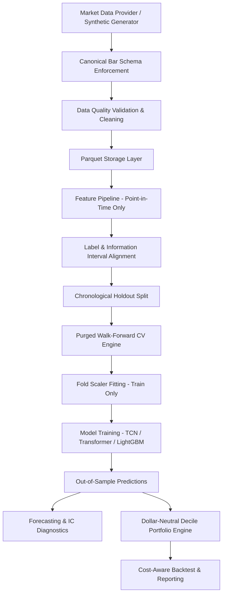

# Architecture Specification

## Overview

The `alpha-volatility` repository is structured as a modular quantitative research framework for intraday financial time series analysis. It adheres strictly to the `src/` layout pattern to ensure clean packaging, separation of concerns, and reproducible research workflows.

## Directory Layout & Module Responsibilities

```text
src/alpha_volatility/
├── config.py              # Strongly-typed configuration validation & loader
├── logging_config.py      # Structured logging formatters
├── reproducibility.py     # Deterministic seed control across Python, NumPy, PyTorch
├── data/                  # Ingestion, canonical schemas, validation, cleaning, and storage
├── features/              # Point-in-time technical, temporal, and cross-sectional features
├── labels/                # Forward return targets, realized volatility, and info intervals
├── validation/            # Purged walk-forward cross validation, embargo, and fold diagnostics
├── models/                # PyTorch TCN, Transformer, LightGBM, baselines, losses, calibration
├── training/              # Sequence datasets, PyTorch trainer, early stopping, and experiment runner
├── evaluation/            # Forecasting metrics, cross-sectional IC, block bootstrap, portfolio metrics
├── portfolio/             # Signal processing, decile allocation, transaction costs, and backtesting
└── visualization/         # Research report plotting and figure generation
```

## Data Flow Architecture

The data pipeline enforces a strict one-way information flow from market bars to portfolio backtest results:



## Key Contracts and Interfaces

### 1. Data Provider Interface (`BaseMarketDataProvider`)
- Defines `fetch_bars(symbols, start_date, end_date, interval, **kwargs) -> pd.DataFrame`
- Enforces return of canonical OHLCV bars in UTC timestamp format.

### 2. Base Forecaster Interface (`BaseForecaster`)
- Defines `fit(train_data, val_data) -> BaseForecaster`
- Defines `predict(data) -> Dict[str, np.ndarray]` returning `pred_return_mean`, `pred_return_scale`, `pred_return_df`, and `pred_volatility`.
- Defines atomic `save(path)` and `load(path)`.

### 3. Feature Pipeline Interface (`FeaturePipeline`)
- Pure point-in-time feature extraction: observations at timestamp $t$ depend strictly on data $\tau \le t$.
- Independent scaler fitting strictly on training fold subsets.

### 4. Leakage-Resistant Validation Engine (`PurgedWalkForwardCV`)
- Computes exact label information intervals $[t, t+h]$ for each sample.
- Purges any training observation whose interval overlaps with validation periods:
  $$\max(T_{start}, V_{start}) \le \min(T_{end}, V_{end})$$
- Applies post-validation embargo periods to eliminate autoregressive serial correlation.

## Atomic Artifact Management

Checkpoints and manifests are saved using temporary file swap semantics to prevent corrupt files upon interruption:
- Checkpoints: `checkpoints/<model_name>_<fold_id>.pt`
- Manifests: `artifacts/manifests/fold_manifest.json` and `artifacts/manifests/experiment_<model_name>.json`
- Metrics: `artifacts/metrics/model_comparison.csv` and `artifacts/metrics/evaluation_summary.json`
- Figures: `artifacts/figures/*.png`
